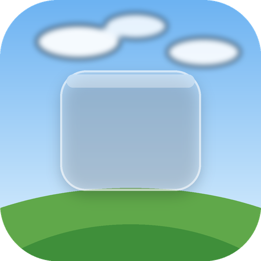
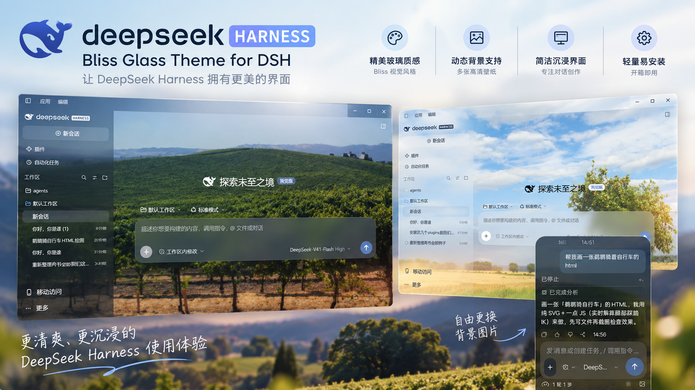
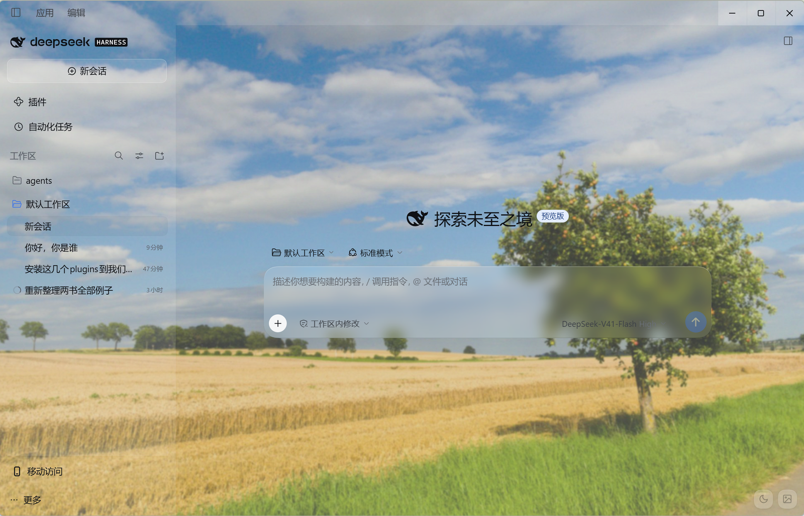
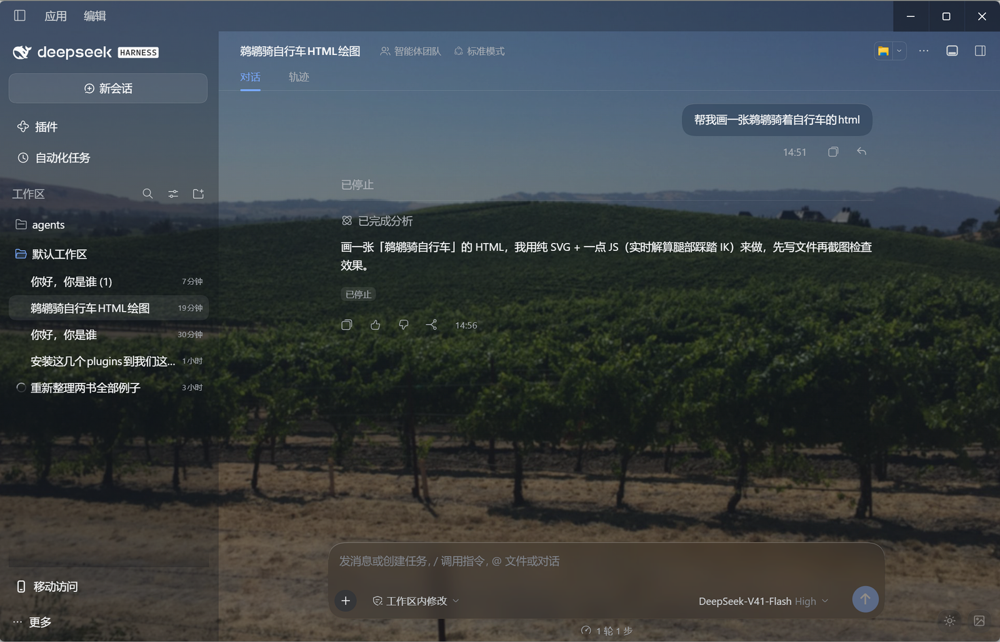
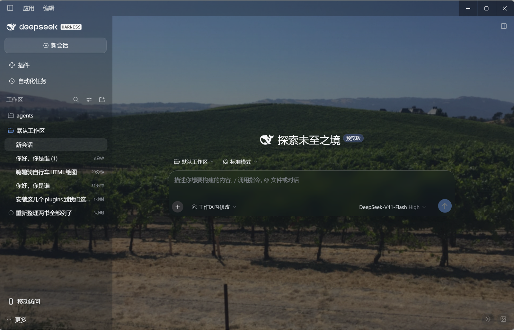
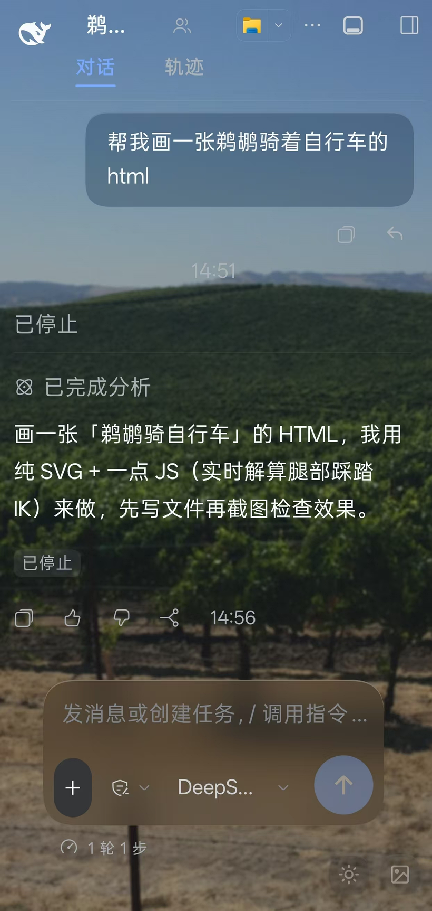

<div align="center">
  
  <h1>Bliss Glass</h1>
  <p><b>Theme for DeepSeek Harness · DeepSeek Harness 主题</b></p>
  <p><i>Where XP nostalgia meets liquid glass.<br/>当 XP 的怀旧风景，遇见现代的液态玻璃。</i></p>
  <p>
    <a href="#中文">简体中文</a> · <a href="#english">English</a>
  </p>
  <p>
    <a href="https://github.com/ahian-lee/dsh-bliss-glass/releases/latest"></a>
    <a href="LICENSE"></a>
    <a href="https://github.com/dsh-market/dsh-market"></a>
    
  </p>
  
</div>

---

## English

A [DeepSeek Harness](https://github.com/deepseek-ai/deepseek-harness) theme built on a simple contrast: the sun-lit, natural scenery wallpapers of the Windows XP era as the desktop backdrop — and every panel of the web UI rendered as modern frosted glass on top of it.

The two halves are deliberate. The wallpaper keeps its colors and calm; the interface becomes translucent, blurred glass — composer, menus, dialogs, bubbles, sidebars — each with a white hairline and a specular highlight, following your light and dark themes. It reads equally well on the desktop surface and on the mobile web UI.

### ✨ Features

|  | English | 中文 |
|---|---|---|
| 🧊 | **Frosted-glass panels** — composer, menus, dialogs, bubbles, sidebars, toasts; blurred backdrop, white hairline, specular highlight | **精美玻璃质感** — 聊天框、菜单、对话框、气泡、侧栏全覆盖 |
| 🖼 | **Dynamic wallpapers** — four bundled sceneries, plus import any image (auto-downscaled & recompressed in-browser) | **动态背景支持** — 内置四张风景，任意图片自动处理后即插即用 |
| 🌗 | **Light / dark toggle** — switches through the official theme service; preference persisted | **明暗一键切换** — 官方主题服务，偏好持久化 |
| 📱 | **Desktop & mobile** — pure CSS; works on the mobile web UI out of the box | **桌面与移动端** — 纯 CSS 实现，开箱即用 |
| 🪶 | **Light & easy** — no build step, no dependencies, no host files touched | **轻量易安装** — 无构建、零依赖、不改宿主文件 |

### 📸 Screenshots

| Light | Dark |
|---|---|
|  |  |

| Night (Bliss hill) | Mobile |
|---|---|
|  |  |

### 📦 Install

**Desktop app (recommended)** — open **Plugins → Add plugin**, paste the repository URL below, and confirm. No profile needs to be chosen; the app targets its own profile for you.

```
https://github.com/ahian-lee/dsh-bliss-glass
```

**Desktop, from the command line** — use the `dsh` that ships with the desktop app. `--profile` is required and must come **before** the pnpm arguments:

```sh
dsh plugin --profile desktop add github:ahian-lee/dsh-bliss-glass
```

**Web / other profiles** — same command with the profile you boot:

```sh
dsh plugin --profile web add github:ahian-lee/dsh-bliss-glass
```

> Running the desktop app? Quit it completely before installing from the command line — the `desktop` profile belongs to the app, and the app rewrites it on exit.

**dsh-market** — or one click from the [dsh-market](https://github.com/dsh-market/dsh-market) **Themes** tab.

### 🧭 Wallpaper picker

Click the small glass button in the bottom-right corner: a menu opens with thumbnails of every wallpaper — pick one, import any image from disk or your phone's gallery, switch to a glass-only mode, or turn the wallpaper off entirely. Your choice, imported images and theme preference all persist across restarts.

### 🔍 How it works (for reviewers)

The client module renders a fixed background layer and applies the frosted styling through DSH **theme tokens** (`--dsw-alias-bg-layer-*`, `--dsw-specific-*`) plus a small set of element rules that prefer DSH's stable semantic hooks (`data-composer-card`, `data-composer-seat`, `data-conversation-region="chat"`, `data-shell-overlay`) and CSS Modules class suffixes (`_bubble`, `_sidebarCol`) instead of hash-prefixed names that change every release. The wallpaper picker downscales and re-encodes imported images with a canvas in the browser; imported images are stored in `localStorage`. No host files are modified and no data leaves the machine.

> Panel hooks are immune to CSS Modules hash churn: stable attributes and class suffixes do not change between releases, and the previously tested hashes are kept only as a fallback. A selector update is needed only if DSH changes the structure or meaning of those attributes.

### 🛠 Robustness (v1.0.3)

Earlier versions could lose their styles for good: if the host rebuilt its DOM, another plugin reloaded, or a hot replace left an orphan node behind, the `<style>` element was detached and the picker degraded into an unstyled bare element — wallpapers gone, thumbnails stretched into full rows. There was no way back short of a manual reload.

v1.0.3 makes the decoration self-healing:

- **Dedicated permanent stylesheet for the picker.** The picker's CSS lives in its own `<style>` that `applyMode()` never rewrites, so it cannot be lost when the light/dark path re-renders.
- **Idempotent cleanup on mount.** Nodes left by a previous instance are removed first, so hot replace can no longer leave an orphaned, style-less menu.
- **Re-attach guard.** A `MutationObserver` on `<head>`/`<body>` plus a 2-second timer re-attaches any detached node. Repairs are recorded in `window.__blissDiag` (`{applies, repairs}`) for troubleshooting.

Appearance is unchanged.
### 🩹 Layout fix (v1.0.4)

On DSH 0.2.2 the sidebar brand mark and the right-hand titlebar controls shifted out of place. The cause was a `:has(> [data-shell-overlay])` selector combined with a `::before` glass layer on the app frame: because `data-windows-titlebar` lives on `<html>`, that selector could match the frame itself and its new `backdrop-filter` became the containing block for `position: fixed` children, so the titlebar row was pushed down and the 40px logo row collapsed.

v1.0.4 drops the `:has()` matcher and the `::before` glass layer. The frame's transparent background stays, and all remaining `backdrop-filter` rules apply to leaf surfaces (cards, bubbles, sidebar column) that own no positioned children. Appearance elsewhere is unchanged.
### 🩹 Sidebar control fix (v1.0.5)

The sidebar toggle and the collapsed "new session" button are `position: fixed`, aligned to the window titlebar row via `top: calc((var(--dsh-windows-titlebar-height) - 28px) / 2)`. That only works while no ancestor establishes a containing block. The plugin's `backdrop-filter` on `[class*="_sidebarCol"]` did exactly that, so those buttons were anchored to the sidebar column and slid down into the padding area.

v1.0.5 removes that rule. The sidebar keeps its translucent glass because the tint comes from `--dsw-specific-sidebar-fill` (10% light / 28% dark), which is unchanged — only the extra blur on the column is gone, and the wallpaper still shows through.
### 🗑 Uninstall

Remove the plugin from the Plugin Manager, or (quit the app first):

```sh
dsh plugin --profile desktop remove dsh-bliss-glass
```

---

## 中文

一个 [DeepSeek Harness](https://github.com/deepseek-ai/deepseek-harness) 主题插件，建立在一场刻意的相遇之上：Windows XP 年代阳光下的自然风光做桌面底色，Web 界面的每一块面板在其上化作现代的磨砂玻璃。

两半各有坚持。壁纸保留它的色彩与安宁；界面化为半透明、带背景模糊的玻璃——聊天框、菜单、对话框、气泡、侧栏，每一块都有白色细描边与一道顶部高光，跟随你的明暗主题。在桌面上，在手机的浏览器里，观感一致。

### ✨ 特色

|  | 功能 | 说明 |
|---|---|---|
| 🧊 | **精美玻璃质感** | 聊天框、菜单、对话框、气泡、侧栏、Toast 全覆盖：背景模糊 + 白描边 + 顶部高光 |
| 🖼 | **动态背景支持** | 内置四张高清风景；任意图片自动缩放压缩后即插即用 |
| 🌗 | **明暗一键切换** | 走官方主题服务，偏好持久化 |
| 📱 | **桌面与移动端** | 纯 CSS 实现，移动版 Web 界面开箱即用 |
| 🪶 | **轻量易安装** | 无构建、零依赖、不改宿主文件 |

### 📸 截图

| 浅色 | 深色 |
|---|---|
|  |  |

| 夜色（Bliss 山丘） | 移动端 |
|---|---|
|  |  |

### 📦 安装

**桌面应用（推荐）**——打开应用内 **插件 → 添加插件**，粘贴下面的仓库地址并确认。不需要选择 profile，应用会自动对接到自己的配置。

```
https://github.com/ahian-lee/dsh-bliss-glass
```

**桌面端命令行**——使用桌面版自带的 `dsh`。`--profile` 是必填项，且必须写在 pnpm 参数**之前**：

```sh
dsh plugin --profile desktop add github:ahian-lee/dsh-bliss-glass
```

**Web / 其他配置**——换成你实际启动的 profile 名称即可：

```sh
dsh plugin --profile web add github:ahian-lee/dsh-bliss-glass
```

> 若正在运行桌面应用，命令行安装前请先**完全退出应用**——`desktop` 配置由应用本身管理，退出时会被应用改写。

**dsh-market**——或在 [dsh-market](https://github.com/dsh-market/dsh-market) 的**主题**分类中一键安装。

### 🧭 壁纸切换器

点击右下角的小玻璃按钮：弹出缩略图菜单——选一张内置壁纸、导入任意本地图片或手机相册图片、切到无壁纸的「纯玻璃」模式，或干脆关掉壁纸。你的选择、导入的图片与主题偏好重启后都在。

### 🔍 实现方式（供评审参考）

Client 模块渲染一层固定背景，并通过 DSH **主题 token**（`--dsw-alias-bg-layer-*`、`--dsw-specific-*`）与少量元素规则应用磨砂样式；元素规则优先用 DSH 自带的稳定语义钩子（`data-composer-card`、`data-composer-seat`、`data-conversation-region="chat"`、`data-shell-overlay`）与 CSS Modules 的类名后缀（`_bubble`、`_sidebarCol`），不再依赖每次发版都会变的哈希前缀。壁纸切换器在浏览器内用 canvas 对导入图片降采样并重新编码；导入的图片存于 `localStorage`。不修改任何宿主文件，数据不出本机。

> 面板钩子对 CSS Modules 哈希变化免疫：稳定属性与类名后缀不随发版改变，已测构建的哈希仅作为回退保留。只有当 DSH 改变这些属性的结构/语义时，才需要更新选择器。

### 🛠 健壮性（v1.0.3）

之前版本一旦掉样式就回不来了：宿主重建 DOM、别的插件重载、或热替换留下孤儿节点时，`<style>` 会被从 head 摘掉，切换器退化成无样式裸元素——壁纸消失、缩略图被拉成整行，除了手动刷新没有别的办法。

v1.0.3 让装饰自愈：

- **切换器专属常驻样式表**：它的 CSS 放在独立的 `<style>` 里，`applyMode()` 永远不会重写它，明暗切换重绘时不会丢。
- **挂载时幂等清理**：先移除上一代实例残留的节点，热替换不再留下无样式的孤儿菜单。
- **重新挂回守卫**：`<head>`/`<body>` 上的 `MutationObserver` 加 2 秒定时器，发现节点脱离文档就立刻挂回；修复记录在 `window.__blissDiag`（`{applies, repairs}`）里便于排查。

外观与之前完全一致。
### 🩹 布局修复（v1.0.4）

在 DSH 0.2.2 上，侧栏品牌标志与右上角标题栏控件会移位。原因是 `:has(> [data-shell-overlay])` 选择器配合应用框架上的 `::before` 玻璃层：`data-windows-titlebar` 挂在 `<html>` 上，该选择器可能匹配到框架自身，而它新增的 `backdrop-filter` 会成为 `position: fixed` 子元素的包含块，于是标题栏整行被下推、40px 的 logo 行被压塌。

v1.0.4 移除 `:has()` 匹配与 `::before` 玻璃层，保留框架的透明背景；其余 `backdrop-filter` 都作用在不含定位子元素的叶子表面（卡片、气泡、侧栏列）上。其他部分外观不变。
### 🩹 侧栏控件定位修复（v1.0.5）

侧栏折叠按钮和收起状态下的「新会话」按钮都是 `position: fixed`，靠 `top: calc((var(--dsh-windows-titlebar-height) - 28px) / 2)` 对齐到窗口标题栏那一行。前提是祖先链上没有元素产生包含块。插件给 `[class*="_sidebarCol"]` 加的 `backdrop-filter` 正好打破了这个前提，于是按钮改以侧栏列为基准定位、滑进了内边距区域。

v1.0.5 移除该规则。侧栏的半透明玻璃感仍然保留——底色来自 `--dsw-specific-sidebar-fill`（浅色 10% / 深色 28%），该 token 未改动，只是去掉了列上那层额外模糊，壁纸照样透得出来。
### 🗑 卸载

在插件管理器中移除，或（先退出应用）：

```sh
dsh plugin --profile desktop remove dsh-bliss-glass
```

---

<div align="center">
  <i>The wallpaper keeps its calm; the interface keeps its clarity.<br/>壁纸守住它的安宁，界面守住它的清透。</i>
</div>

## License / 许可证

[MIT](LICENSE)
